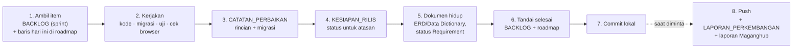

# Peta Dokumen dan Cara Kerja BARUNA

Folder ini berisi acuan kebutuhan, rencana kerja, catatan teknis, laporan, dan output kurikulum magang.
Dokumen ini menjawab tiga pertanyaan:
- dokumen mana yang menjadi patokan untuk apa;
- urutan kerja setiap fitur;
- cara pekerjaan harian mengikuti roadmap kurikulum.

## 1. Peta dokumen

| Pertanyaan | Dokumen patokan | Kapan diisi |
|---|---|---|
| **Apa yang diminta?** (acuan kebutuhan) | `slides/slide-1.png` … `slide-51.png` | Tetap; hanya dibaca |
| **Apa yang dikerjakan minggu ini?** | `output/bulan-1/BACKLOG.md` (sprint) | Item ditandai saat selesai; temuan baru ditambahkan |
| **Apa yang dikerjakan hari ini?** | `roadmap/RENCANA_HARIAN_KURIKULUM.md` | Baris hari itu ditandai ✅ di akhir hari |
| **Seberapa jauh dari kebutuhan?** | `output/bulan-1/FEATURE_GAP_MATRIX.md` | **Potret 18 Nov 2026, tidak ditulis ulang.** Dibandingkan lagi di akhir magang (topik 6.4) |
| **Apa yang diubah, kenapa, migrasi apa, buktinya?** | `CATATAN_PERBAIKAN.md` | **Setiap perubahan.** Bagian 3 memuat daftar migrasi yang wajib dijalankan |
| **Seberapa siap dirilis?** (untuk atasan) | `KESIAPAN_RILIS.md`, tampil di `/kesiapanrilis` | Setiap fitur selesai |
| **Apa yang menunggu keputusan?** | `MENUNGGU_ARAHAN_MENTOR.md` | Saat ada pertanyaan baru atau keputusan |
| **Masalah dan risiko apa yang terbuka?** | `output/bulan-1/INITIAL_ISSUE_REGISTER.md` | Saat ada temuan baru atau isu selesai |
| **Apa yang dikerjakan hari itu?** (laporan) | `LAPORAN_PERKEMBANGAN_BARUNA.md` dan laporan Maganghub | Saat push |
| **Aturan teknis** | `../AGENTS.md`, `ENGINEERING_STANDARDS.md` | Jarang berubah |
| **Output kurikulum per bulan** | `output/bulan-N/` (indeks Bulan 1: `DOKUMEN_PEMETAAN_KONDISI.md`), tampil di tab *Output Kurikulum* `/kesiapanrilis` | Sesuai topik minggu itu |
| Arsip (tidak diubah lagi) | `AUDIT_PERAN.md`, `LAPORAN_AUDIT_DAN_MITIGASI_BOM_WAKTU.md`, `RANCANGAN_KONSOL_GOVERNANCE.md` | – |

### Folder pribadi (tidak ada di Git)

`dokumen/output/` dan `dokumen/roadmap/` adalah dokumen magang pribadi. Keduanya dikecualikan lewat `.gitignore`, sehingga tidak ikut push, pull, atau clone, dan disinkronkan antar-perangkat lewat Google Drive. Di salinan repo yang tidak punya folder ini, tab *Output Kurikulum* di `/kesiapanrilis` kosong dengan sendirinya.

### Satu informasi, satu tempat

Supaya satu perubahan tidak perlu ditulis berkali-kali:
- **Keputusan yang ditunggu** ditulis lengkap hanya di `MENUNGGU_ARAHAN_MENTOR.md`. `KESIAPAN_RILIS.md` bagian B dan Issue Register cukup merujuk butirnya.
- **Rincian teknis** (berkas, migrasi, uji) hanya di `CATATAN_PERBAIKAN.md`. KESIAPAN cukup ringkasan dan nomor bagiannya (mis. "CATATAN_PERBAIKAN 2bn").
- **Daftar pekerjaan** hanya di `BACKLOG.md`. Roadmap harian memecahnya per hari.

### Dokumen potret dan dokumen hidup (output kurikulum)

| Jenis | Dokumen | Perlakuan |
|---|---|---|
| **Potret** (bukti kondisi pada tanggalnya) | Dokumen Pemetaan Kondisi, Feature Gap Matrix, Business Process Map bagian as-is | Tidak ditulis ulang. Perubahan besar ditambahkan sebagai catatan bertanggal |
| **Hidup** (selalu mutakhir) | ERD, Data Dictionary, Role-Permission Matrix | Dibuat ulang dari database setiap ada migrasi |
| | Requirement List, User Story, Business Rules | Kolom status diubah saat fitur selesai; baris ditambah untuk aturan baru |
| | Issue Register, Backlog | Diperbarui setiap akhir sprint |
| | System Architecture, Integration Register, SoR Mapping | Ditambah saat ada komponen atau integrasi baru (email, AI, pembayaran) |
| | Infrastructure Inventory, Dev Environment, Data Migration Plan | Dilengkapi saat konfigurasi atau data berubah |

Di Bulan 6 (topik 6.3), dokumen hidup ini difinalkan menjadi Technical Documentation.

## 2. Cara kerja setiap fitur

| Langkah | Isi | Wajib bila |
|---|---|---|
| 1 | Ambil item sprint minggu ini dari `BACKLOG.md`, lalu cocokkan dengan baris hari ini di roadmap. Baca slide acuannya | Selalu |
| 2 | Kode, migrasi (`supabase/migrations/`), uji otomatis, cek di browser. `npm run build` harus exit 0 | Selalu |
| 3 | `CATATAN_PERBAIKAN.md`: bagian baru (2xx) berisi apa, kenapa, berkas, uji. Migrasi baru juga dicatat di bagian 3 dan `supabase/check_migrations.sql` | Selalu; migrasi bila ada |
| 4 | `KESIAPAN_RILIS.md`: butir di bagian A (selesai) atau B (belum), format `- **Judul (tanggal):** isi` | Fitur atau perbaikan yang terlihat pengguna |
| 5 | Dokumen hidup yang terdampak (lihat tabel di atas) | Bila ada tabel, peran, aturan, atau komponen baru |
| 6 | Tandai ✅ di `BACKLOG.md` dan baris roadmap | Selalu |
| 7 | Commit lokal, pesan bahasa Indonesia `jenis(area): ringkasan`. Jangan commit `.env` | Selalu |
| 8 | Push ke `intern-update` **hanya saat diminta**; tambah entri `LAPORAN_PERKEMBANGAN_BARUNA.md`; laporan Maganghub | Saat push |

Setelah setiap fitur, pemilik proyek mendapat **langkah uji manual**. Hasilnya dicatat di KESIAPAN ("diuji manual oleh pemilik proyek …").

## 3. Ritme mengikuti roadmap kurikulum

| Waktu | Kegiatan |
|---|---|
| **Pagi** | `git pull`; baca baris hari ini di `RENCANA_HARIAN_KURIKULUM.md` |
| **Hari 1 sprint (Senin)** | Rancang tabel, migrasi, RLS, dan aturan bisnis; kirim pertanyaan untuk **minggu depan** ke `MENUNGGU_ARAHAN_MENTOR.md` |
| **Hari 2–4** | Bangun satu bagian per hari, dan setiap hari bisa dicoba |
| **Hari 5 (Jumat)** | Uji manual oleh pemilik proyek; simpan output topik itu di `output/bulan-N/`; perbarui Backlog dan Issue Register |
| **Akhir hari** | Langkah 3–7 di atas; laporan Maganghub |
| **Akhir bulan** | Rekap bulan di roadmap; pastikan semua output kurikulum bulan itu ada di `output/bulan-N/` |

Topik yang molor dipindah ke hari cadangan atau ke Backlog, supaya bulan berikutnya tidak bergeser.

## 4. Acuan slide (51 slide, `slides/`)

Pembagian berikut sesuai isi slide (dibaca ulang 18 Nov 2026):

| Slide | Isi |
|---|---|
| 1–18 | Gambaran umum: tujuan, simbol BPMN, swimlane, 8 menu, prinsip, arsitektur, jalur partisipasi, pola workflow (13), sumber data (14–15), role dan hak akses (16), integrasi dan System of Record (17), peta proses (18) |
| 19–28 | Academy: overview, PB-ACA-01 Master Course (20), 02 Course Offering (21), 03 Application & Enrollment (22), 04 Pembelajaran & Asesmen (23), 05 Completion & Sertifikat (24), 06 Request a Training (25), backend objects (26), role & workflow (27), output (28) |
| 29–34 | Knowledge Hub: overview, PB-KHU-01 Resource & Version (30), 02 Contribute Knowledge (31), backend objects (32), role & workflow (33), output (34) |
| 35–41 | Experts: overview, PB-EXP-01 Expert Profile (36), 02 Join & Profile Claim (37), 03 Assignment & Facilitation (38), backend objects (39), output (40), keterhubungan antar modul (41) |
| 42–50 | Tata kelola lintas sistem: LS-01 Akun & Role (42), LS-02 Admin Console (43), LS-03 Impor & Data Historis (44), LS-04 Publikasi/Arsip (45), LS-05 Tarif & PNBP (46), LS-06 Integrasi (47), LS-07 Pengujian & UAT (48), LS-08 RACI (49), LS-09 Tahapan Implementasi (50) |
| 51 | Penutup |
